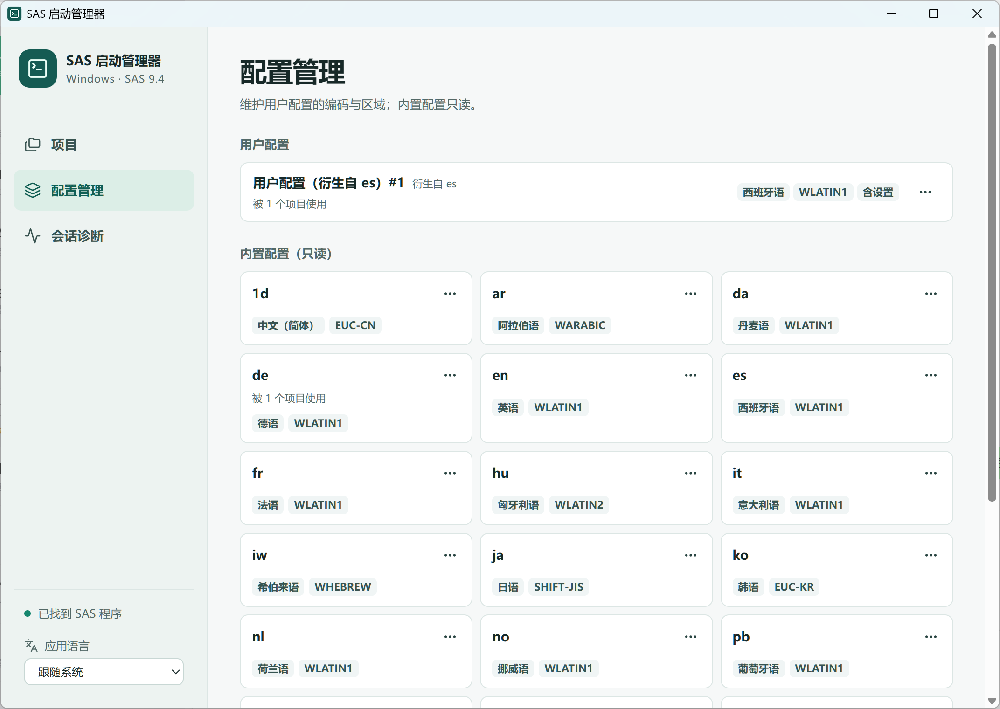

# SAS Launcher

Ejecutar varios proyectos SAS 9.4 en paralelo en la misma máquina, cada uno con su propio entorno de sesión.


[](https://github.com/wtwang1998/sas-launcher/actions/workflows/ci.yml)

[English](./README.md) | [简体中文](./README.zh-CN.md) | [繁體中文](./README.zh-Hant.md) | [日本語](./README.ja.md) | [한국어](./README.ko.md) | [Deutsch](./README.de.md) | [Français](./README.fr.md) | **Español**

## Por qué

SAS puede abrir varias ventanas a la vez. El problema no es abrirlas, sino que todas comparten la misma carpeta de preferencias del usuario (`SASUSER`): fuentes, colores, estado de las ventanas y la biblioteca de plantillas predeterminada de `PROC TEMPLATE` viven en esa única carpeta, y SAS exige acceso exclusivo para actualizarla (la [opción de sistema RSASUSER](https://support.sas.com/documentation/cdl/en/hostwin/69955/HTML/default/n0npwfu9o7rvtun1f8f4ztpug83z.htm)).

La segunda ventana recurre entonces a una copia en la biblioteca Work, todo luce como de fábrica y los cambios se pierden al salir:

> `NOTE: No se puede abrir SASUSER.PROFILE. Se abrirá WORK.PROFILE.`

Con las tablas es más directo: la plantilla ODS RTF propia del proyecto no puede escribirse en esa carpeta, `PROC TEMPLATE` falla en el acto y después solo queda el estilo predeterminado: esa ventana ejecuta programas, pero no produce la tabla que necesita. La opción oficial `ODS PATH` resuelve las plantillas, no las preferencias; «un acceso directo por proyecto» funciona, pero con muchos proyectos acaba siendo un montón de iconos.

SAS Launcher da a cada proyecto su propia configuración y prepara para cada arranque una carpeta `SASUSER` independiente y escribible, que se elimina al terminar la sesión. Así varios proyectos pueden generar tablas a la vez sin estorbarse.


## Funciones

**Tres orígenes de configuración**

- Seguir la configuración predeterminada de la instalación; elegir una configuración NLS de fábrica (`zh`, `u8`, `en`…, una por cada `nls\\<code>\\sasv9.cfg`, normalmente más de veinte); o derivar de cualquiera de ellas una configuración de usuario.
- Una configuración de usuario es un `sasv9.cfg` fino de tres líneas: `-CONFIG` apunta al archivo de fábrica, más codificación y configuración regional, y puede llevar los cuatro archivos de ajustes de SAS que guarda. El contenido del archivo de fábrica no se copia, así que una actualización de SAS se hereda de forma automática en lugar de repasarse archivo por archivo.
- La codificación y la configuración regional se cambian en el formulario, o abriendo una sesión SAS dedicada para ajustar las preferencias de interfaz y guardando el catálogo en la configuración al salir.



**Un entorno por ventana**

- Cada arranque tiene su propia carpeta `-SASUSER` independiente y escribible, que se elimina al terminar la sesión.
- De forma predeterminada el proyecto se lleva los ajustes de interfaz y de entorno (disposición de ventanas, teclas de función, menús, opciones del Explorador y asignaciones de bibliotecas) y recupera los cambios al salir, sea cual sea el código de salida. Las plantillas ODS siguen marcándose a mano.
- Se pueden lanzar de una vez los proyectos habituales; los que ya están en marcha se omiten.

**Código de arranque propio del proyecto**

- Un proyecto puede indicar su propio archivo autoexec. En cada arranque SAS lo ejecuta antes de aceptar cualquier entrada: variables globales, carpetas de datos brutos, de análisis y de TFL, y bibliotecas de macros se configuran una vez en el proyecto en lugar de repetirse en cada sesión.
- Se añade a la cadena autoexec del sitio mediante `-APPEND AUTOEXEC`, así que el directorio de instalación o un `autoexec.sas` propio siguen ejecutándose primero. Si el archivo no existe, se rechaza el arranque en lugar de abrir una sesión con una ruta incompleta.
- Al activar «Proporcionar a la sesión la ruta del archivo de arranque», el script puede leer `&SASLAUNCHER_STARTUP_FILE`. El lanzador ejecuta antes de los archivos del proyecto un preludio mínimo que lo define: SAS restablece `SAS_EXECFILEPATH` durante el arranque de una sesión con ventana, y una ruta no ASCII tampoco atraviesa la capa de variables de entorno en una sesión UTF-8, así que la ruta se entrega como variable de macro. Un script que solo lee `%sysget(SAS_EXECFILEPATH)` se rechaza en el arranque en lugar de entrar con una ruta vacía.
- Un script de inicialización ya escrito con `%sysget(SAS_EXECFILEPATH)` se puede corregir desde ese mismo rechazo: al pulsar «Migrar archivo de arranque», el lanzador reescribe la asignación conocida como comprobación `%symexist`, conserva el original como `<nombre>.bak`, activa la opción y reinicia. El resto del archivo no se toca; un script cuyas referencias queden fuera del alcance se rechaza en lugar de reescribirse a medias.
- Alcance: sesiones de SAS 9.4 Foundation en Windows iniciadas por este lanzador. El script se engancha a la cadena autoexec de una sesión con ventana, así que la opción no afecta a Enterprise Guide, SAS Studio, SAS Grid ni SAS en Linux/Unix. Tampoco supone una jerarquía de carpetas del proyecto: la ruta la da el proyecto en absoluto, el nombre del archivo es libre y la reescritura no decodifica el archivo como texto, de modo que un script GBK sigue siendo GBK tras la migración. Si un script deduce la raíz del proyecto a partir de la ruta, el número de niveles es convención suya; la migración no toca ese cálculo.
- La migración solo reconoce una forma: una asignación `%let` cuyo lado derecho es exactamente `%sysget(SAS_EXECFILEPATH)`. Otras formas de localización no se modifican ni se avisan, por ejemplo `&_SASPROGRAMFILE`, `%sysfunc(getoption(sysin))` o una ruta leída de otro archivo.

Basta buscar `SAS_EXECFILEPATH`, `_SASPROGRAMFILE` y `getoption(sysin)` en el script para saber en qué caso está:

| Forma en el script de arranque | Qué hacer |
| --- | --- |
| `%let <nombre> = %sysget(SAS_EXECFILEPATH);` | pulsar «Migrar archivo de arranque» |
| `&_SASPROGRAMFILE`, `%sysfunc(getoption(sysin))`, ruta leída de otro archivo | reescribir a mano con el modelo de abajo |
| ruta escrita a mano, o script que no se localiza | no hay que cambiar nada |

Todos los casos acaban en el mismo código, y es justo lo que escribe el botón de migración. El valor de `&SASLAUNCHER_STARTUP_FILE` es la ruta del propio archivo de arranque, igual al valor de `SAS_EXECFILEPATH` al enviar un programa en la sesión:

```sas
%if %symexist(SASLAUNCHER_STARTUP_FILE) %then %do;
    %let <name> = &SASLAUNCHER_STARTUP_FILE;
%end;
%else %do;
    %let <name> = %sysget(SAS_EXECFILEPATH);  /* the original fallback */
%end;
```


**Diagnóstico para investigar**

- Cada registro conserva la cadena de resolución (cfg fino → cfg de fábrica → codificación, configuración regional y `SASUSER` realmente aplicados), los argumentos de arranque reales, la fase que falló y el código de salida.
- El registro de SAS se captura con `-ALTLOG` y se escribe una copia: la ventana Log sigue disponible. Solo se conservan los últimos 20 registros.


## Requisitos

> [!IMPORTANT]
> La máquina debe tener SAS Foundation 9.4 instalado y con licencia. SAS Launcher solo lo inicia y no incluye SAS.

- Windows 10 u 11, x64
- SAS Foundation 9.4 (probado con TS1M7)
- Runtime de WebView2: incluido en Windows 11; en Windows 10 puede hacer falta el Evergreen Runtime. Las barras de desplazamiento superpuestas nativas requieren la versión 125 o posterior; las anteriores vuelven a las clásicas

## Instalación

1. Descargar `SAS-Launcher-0.4.0-x64-Setup.exe` desde [Releases](https://github.com/wtwang1998/sas-launcher/releases).
2. El instalador solo instala para el usuario actual, en `%LOCALAPPDATA%\\SAS Launcher`, y no necesita permisos de administrador.
3. La actualización y la desinstalación usan esa misma carpeta.

> [!NOTE]
> El instalador no está firmado, por lo que Windows SmartScreen mostrará «Windows ha protegido tu PC». Es lo normal en una compilación sin firmar: elegir **Más información** → **Ejecutar de todas formas**. Descargar solo desde la página Releases de este repositorio.

### Datos y desinstalación

Los proyectos, las configuraciones y los diagnósticos se guardan en `%LOCALAPPDATA%\\com.saslauncher.desktop`, sin relación con dónde esté instalado el programa. La desinstalación solo borra los archivos del programa y conserva los datos; para empezar de cero, borrar esa carpeta a mano.

## Ajustes

**Ajustes** reúne los interruptores de la aplicación; todos se aplican al instante y no hay botón de guardar.

- **Tema**: seguir al sistema o forzar oscuro/claro. Cada color es un par `light-dark()`, y la barra de título, las listas nativas y las barras de desplazamiento lo acompañan; hace falta un runtime de WebView2 reciente.
- **Idioma de la aplicación**: 简体中文, 繁體中文, English, 日本語, 한국어, Deutsch, Français, Español o seguir al sistema. El instalador tiene por su cuenta 23 idiomas de interfaz y recuerda la elección.
- **Ruta del programa SAS**: muestra el `sas.exe` detectado; se puede escribir a mano, examinar, o usar «Detección automática» para abandonar la ruta manual y volver a buscar.
- **Iniciar automáticamente al iniciar sesión**: escribe en `HKCU\\Software\\Microsoft\\Windows\\CurrentVersion\\Run` del usuario actual; una ruta con espacios arranca correctamente.
- **Minimizar a la bandeja del sistema al iniciar**: solo el arranque automático de la sesión inicia en silencio; la fila aparece al activar «Iniciar automáticamente al iniciar sesión», su valor se conserva al desactivarlo y vuelve a aplicarse al reactivarlo.
- **Minimizar a la bandeja del sistema al cerrar**: activado de forma predeterminada: cerrar la ventana solo la oculta (el icono ofrece «Mostrar ventana» y «Salir»). Desactivado, cerrar sale de la aplicación, aunque pregunta antes si hay sesiones SAS en marcha; al volver a iniciar el programa, la ventana oculta regresa.

## Inicio rápido


1. Iniciar la aplicación: encuentra sola el SAS 9.4 instalado; si no, el aviso permite elegir `sas.exe` a mano.
2. En **Configuraciones**, explorar las configuraciones de fábrica o derivar una de usuario y ajustar su codificación y configuración regional.
3. En **Proyectos**, crear uno nuevo: nombre, uno de los tres orígenes de configuración, origen de las preferencias del usuario (heredar los ajustes de interfaz de `My SAS Files`, heredar los ajustes de sesión guardados por una configuración, o entorno limpio), nota opcional y archivo de código de arranque opcional.
4. Para cambiar las preferencias de interfaz de SAS de una configuración, elegir «Abrir SAS para ajustar los parámetros», y al terminar salir de SAS y guardar.
5. Si un arranque va mal, abrir **Diagnóstico de sesión** para ver la cadena de resolución, los argumentos y el registro.
6. En **Ajustes**, cambiar el tema, el idioma, la ruta del programa SAS y el comportamiento al cerrar y al iniciar sesión.

## Limitaciones conocidas

- La fuente, los colores y las teclas del **editor mejorado** de SAS se guardan en el registro de Windows (`HKCU`). SAS no ofrece una opción para cambiarlos de sitio, así que esa parte no se puede aislar ni guardar por configuración. Es una limitación de SAS, no una función que falte.
- Los datos anteriores a 0.2 no se migran: la carpeta antigua se archiva como `_old-<fecha>` dentro de la carpeta de datos de la aplicación, que empieza de cero.

## Compilar desde el código fuente

Hacen falta la cadena de herramientas Rust MSVC (edition 2024), Visual Studio C++ Build Tools, Node.js y el runtime de WebView2. El repositorio fija Rust 1.99.1 con `rust-toolchain.toml` y Node 24.22.3 con `.nvmrc`; `rustup` y `nvm` los eligen solos.

```powershell
winget install --id Rustlang.Rustup
winget install --id Microsoft.VisualStudio.2022.BuildTools --override "--wait --passive --add Microsoft.VisualStudio.Workload.VCTools --includeRecommended"

git clone https://github.com/wtwang1998/sas-launcher.git
cd sas-launcher
npm ci
npm run tauri dev
```

La primera compilación de las dependencias de Rust tarda unos 3 a 10 minutos. Los cambios en `src/**` usan recarga en caliente; los de `src-tauri/**` recompilan y reinician la ventana.

| Comando | Para qué |
| --- | --- |
| `npm run check` | todas las comprobaciones: formato, lint, clippy, tipos y las dos suites de pruebas (unos 12 segundos) |
| `npm run test` / `npm run test:rust` | frontend (vitest) / backend (cargo test) |
| `npm run build` | comprobación de tipos y luego compilación del frontend |
| `npm run tauri build` | compila la aplicación y genera el instalador NSIS en `src-tauri/target/release/bundle/nsis/` |

¿Desarrollar con un agente de IA? Leer primero [AGENTS.md](AGENTS.md): describe las invariantes que las pruebas no cubren.

## Integración continua

Cada pull request y cada push a `main` ejecuta en `windows-latest` las mismas comprobaciones que en local, en tres trabajos paralelos: `web` (formato, lint, tipos, pruebas del frontend, compilación), `rust` (cargo fmt, clippy, pruebas del backend y coherencia de `Cargo.lock` con el manifiesto) y `commitlint`.

Publicar una etiqueta `v<version>` lanza la publicación: si la etiqueta no coincide con las tres versiones de `package.json`, `src-tauri/Cargo.toml` y `src-tauri/tauri.conf.json`, se rechaza la compilación; si coincide, se genera un instalador sin firmar en un borrador de release a la espera de revisión humana.

Se agradecen las contribuciones: ver [CONTRIBUTING.md](CONTRIBUTING.md).

## Licencia

Publicado bajo [GPL-3.0-or-later](LICENSE).
