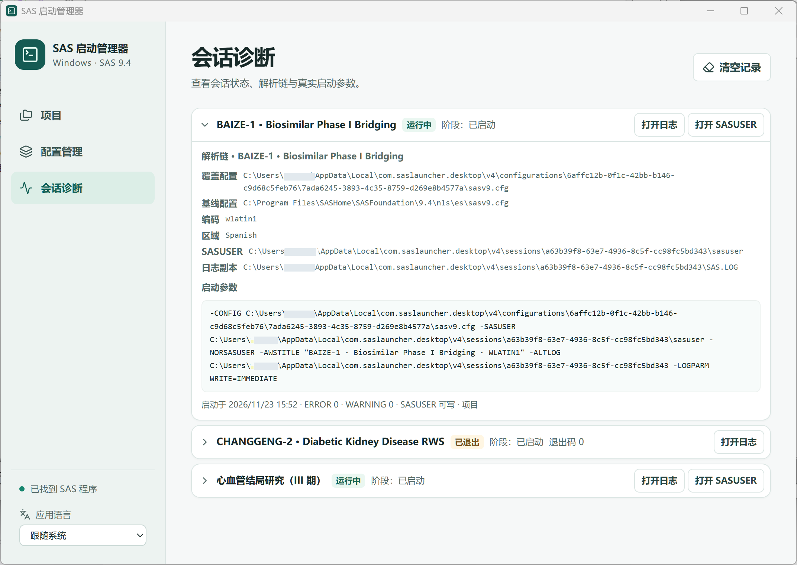

# SAS Launcher

Exécuter plusieurs projets SAS 9.4 en parallèle sur une même machine, chacun avec son propre environnement de session.


[](https://github.com/wtwang1998/sas-launcher/actions/workflows/ci.yml)

[English](./README.md) | [简体中文](./README.zh-CN.md) | [繁體中文](./README.zh-Hant.md) | [日本語](./README.ja.md) | [한국어](./README.ko.md) | [Deutsch](./README.de.md) | **Français** | [Español](./README.es.md)

## Pourquoi

SAS sait ouvrir plusieurs fenêtres. Le problème n’est pas le lancement multiple, mais le fait que toutes les fenêtres partagent le même dossier de préférences utilisateur (`SASUSER`) : polices, couleurs, état des fenêtres et bibliothèque de modèles par défaut de `PROC TEMPLATE` y vivent, et SAS exige un accès exclusif en écriture sur ce dossier ([option système RSASUSER](https://support.sas.com/documentation/cdl/en/hostwin/69955/HTML/default/n0npwfu9o7rvtun1f8f4ztpug83z.htm)).

La seconde fenêtre retombe donc sur une copie dans la bibliothèque Work, tout y est par défaut, et les modifications sont perdues à la fermeture :

> `NOTE: Impossible d’ouvrir SASUSER.PROFILE. Ouverture de WORK.PROFILE.`

Pour les tableaux, c’est plus direct : le modèle ODS RTF propre au projet ne peut pas être écrit dans ce dossier, `PROC TEMPLATE` échoue immédiatement, puis seul le style par défaut reste disponible – la fenêtre exécute bien les programmes, mais ne produit pas le tableau attendu. L’option officielle `ODS PATH` ne règle que les modèles, pas les préférences ; « un raccourci par projet » fonctionne, mais se transforme vite en une pile d’icônes.

SAS Launcher donne à chaque projet sa propre configuration et prépare pour chaque lancement un dossier `SASUSER` distinct et inscriptible, supprimé à la fin de la session. Plusieurs projets peuvent donc produire des tableaux en même temps sans se gêner.


## Fonctionnalités

**Trois sources de configuration**

- Suivre la configuration par défaut livrée avec l’installation ; choisir l’une des configurations NLS d’usine (`zh`, `u8`, `en`…, une par `nls\\<code>\\sasv9.cfg`, souvent plus de vingt) ; ou en dériver une configuration utilisateur.
- Une configuration utilisateur est une fine coquille `sasv9.cfg` de trois lignes – `-CONFIG` pointe vers le fichier d’usine, plus l’encodage et la locale – et peut emporter les quatre fichiers de réglages SAS qu’elle enregistre. Le contenu du fichier d’usine n’est pas recopié : une montée de version de SAS est donc héritée automatiquement, sans retouche fichier par fichier.
- L’encodage et la locale se modifient dans le formulaire, ou en ouvrant une session SAS dédiée pour ajuster les préférences d’interface, puis en sauvegardant le catalogue dans la configuration à la sortie.


**Un environnement par fenêtre**

- Chaque lancement dispose d’un dossier `-SASUSER` distinct et inscriptible, supprimé à la fin de la session.
- Par défaut, un projet emporte les réglages d’interface et d’environnement – disposition des fenêtres, touches de fonction, menus, options de l’Explorateur et affectations de bibliothèques – et récupère les modifications à la fermeture, quel que soit le code de sortie. Les modèles ODS restent à cocher à la main.
- Il est possible de lancer d’un coup les projets habituels ; ceux déjà en cours sont ignorés.

**Code de démarrage propre au projet**

- Un projet peut désigner son propre fichier autoexec. À chaque lancement, SAS l’exécute avant toute entrée : variables globales, dossiers de données brutes, d’analyse et de TFL, bibliothèques de macros se configurent une fois dans le projet au lieu d’être répétés à chaque session.
- Il est ajouté à la chaîne autoexec du site via `-APPEND AUTOEXEC`, donc le dossier d’installation ou un `autoexec.sas` maison s’exécute toujours d’abord. Si le fichier manque, le lancement est refusé plutôt que d’ouvrir une session au chemin incomplet.
- Avec « Fournir le chemin du fichier de démarrage à la session », le script peut lire `&SASLAUNCHER_STARTUP_FILE`. Le lanceur exécute avant les fichiers du projet un préambule minimal qui le définit : SAS réinitialise `SAS_EXECFILEPATH` au démarrage d’une session fenêtrée, et un chemin non ASCII ne traverse pas non plus la couche des variables d’environnement en session UTF-8 ; le chemin est donc transmis par variable de macro. Un script qui ne lit que `%sysget(SAS_EXECFILEPATH)` est refusé au lancement plutôt que d’arriver avec un chemin vide.
- Un script d’initialisation déjà écrit avec `%sysget(SAS_EXECFILEPATH)` se répare directement depuis ce refus : « Migrer le fichier de démarrage » réécrit l’affectation connue en test `%symexist`, conserve l’original en `<nom>.bak`, active l’option et relance. Le reste du fichier n’est pas touché ; un script dont les références sortent du périmètre est refusé plutôt que réécrit à moitié.
- Périmètre : sessions SAS 9.4 Foundation sous Windows, lancées par ce lanceur. Le script étant accroché à la chaîne autoexec d’une session fenêtrée, l’option n’a aucun effet sur Enterprise Guide, SAS Studio, SAS Grid ni SAS sous Linux/Unix. Aucune hiérarchie de dossiers du projet n’est supposée : le chemin est fourni en absolu par le projet, le nom de fichier est libre, et la réécriture ne décode pas le fichier en texte – un script GBK reste GBK après migration. Si un script déduit la racine du projet du chemin, le nombre de niveaux relève de sa propre convention ; la migration n’y touche pas.
- La migration ne reconnaît qu’une écriture : une affectation `%let` dont la partie droite est entièrement `%sysget(SAS_EXECFILEPATH)`. Les autres localisations ne sont ni modifiées ni signalées, par exemple `&_SASPROGRAMFILE`, `%sysfunc(getoption(sysin))` ou un chemin lu dans un autre fichier.

Chercher `SAS_EXECFILEPATH`, `_SASPROGRAMFILE` et `getoption(sysin)` dans le script suffit à déterminer le cas :

| Écriture dans le script de démarrage | Traitement |
| --- | --- |
| `%let <nom> = %sysget(SAS_EXECFILEPATH);` | cliquer sur « Migrer le fichier de démarrage » |
| `&_SASPROGRAMFILE`, `%sysfunc(getoption(sysin))`, chemin lu dans un autre fichier | reprendre à la main le modèle ci-dessous |
| chemin en dur, ou script qui ne se localise pas | rien à changer |

Tous ces cas aboutissent au même code, et c’est exactement ce que la migration écrit. La valeur de `&SASLAUNCHER_STARTUP_FILE` est le chemin du fichier de démarrage lui-même, égale à la valeur de `SAS_EXECFILEPATH` lorsqu’on soumet un programme dans la session :

```sas
%if %symexist(SASLAUNCHER_STARTUP_FILE) %then %do;
    %let <name> = &SASLAUNCHER_STARTUP_FILE;
%end;
%else %do;
    %let <name> = %sysget(SAS_EXECFILEPATH);  /* the original fallback */
%end;
```


**Des diagnostics pour comprendre**

- Chaque entrée conserve la chaîne de résolution (coquille cfg → cfg d’usine → encodage, locale et `SASUSER` réellement appliqués), les arguments de lancement réels, l’étape en échec et le code de sortie.
- Le journal SAS est capté via `-ALTLOG`, sous forme de copie : la fenêtre Log reste utilisable. Seules les 20 dernières entrées sont conservées.



## Configuration requise

> [!IMPORTANT]
> SAS Foundation 9.4 doit être installé et sous licence sur la machine. SAS Launcher ne fait que le lancer et ne fournit pas SAS.

- Windows 10 ou 11, x64
- SAS Foundation 9.4 (vérifié avec TS1M7)
- Runtime WebView2 – fourni avec Windows 11 ; sous Windows 10, l’Evergreen Runtime peut être nécessaire. Les barres de défilement superposées natives exigent la version 125 ou plus récente, les plus anciennes retombent sur les barres classiques

## Installation

1. Télécharger `SAS-Launcher-0.4.0-x64-Setup.exe` depuis les [Releases](https://github.com/wtwang1998/sas-launcher/releases).
2. L’installateur n’installe que pour l’utilisateur courant, dans `%LOCALAPPDATA%\\SAS Launcher`, sans droits administrateur.
3. La mise à jour et la désinstallation réutilisent ce dossier.

> [!NOTE]
> L’installateur n’est pas signé, Windows SmartScreen affiche donc « Windows a protégé votre ordinateur ». C’est normal pour une compilation non signée : choisir **Informations complémentaires** → **Exécuter quand même**. Ne télécharger que depuis la page Releases de ce dépôt.

### Données et désinstallation

Projets, configurations et diagnostics sont enregistrés dans `%LOCALAPPDATA%\\com.saslauncher.desktop`, indépendamment du dossier d’installation. La désinstallation ne supprime que les fichiers du programme, les données restent ; pour repartir de zéro, supprimer ce dossier à la main.

## Paramètres

**Paramètres** regroupe les interrupteurs de l’application ; tous s’appliquent immédiatement, il n’y a pas de bouton d’enregistrement.

- **Thème** – suivre le système, ou forcer sombre/clair. Chaque couleur est une paire `light-dark()`, la barre de titre, les listes natives et les barres de défilement suivent ; cela demande un runtime WebView2 assez récent.
- **Langue de l’application** – 简体中文, 繁體中文, English, 日本語, 한국어, Deutsch, Français, Español, ou suivre le système. L’installateur propose de son côté 23 langues d’interface et retient le choix.
- **Chemin du programme SAS** – affiche le `sas.exe` détecté ; saisie manuelle, parcours, ou « Détection automatique » pour abandonner la valeur manuelle et relancer l’analyse.
- **Lancer automatiquement à l’ouverture de session** – écrit dans `HKCU\\Software\\Microsoft\\Windows\\CurrentVersion\\Run` de l’utilisateur courant ; un chemin contenant des espaces démarre correctement.
- **Réduire dans la zone de notification au démarrage** – seul le lancement automatique à l’ouverture de session démarre en silence ; la ligne n’apparaît qu’une fois « Lancer automatiquement à l’ouverture de session » activé, sa valeur est conservée quand on le désactive et revient au réactivé.
- **Réduire dans la zone de notification à la fermeture** – activé par défaut : fermer la fenêtre la masque simplement, l’icône propose « Afficher la fenêtre » et « Quitter ». Désactivé, fermer quitte l’application, après confirmation s’il reste des sessions SAS ; relancer le programme ramène la fenêtre masquée.

## Démarrage rapide


1. Lancer l’application : elle trouve seule le SAS 9.4 installé ; sinon, la bannière permet de choisir `sas.exe` à la main.
2. Dans **Configurations**, parcourir les configurations d’usine, ou dériver une configuration utilisateur et ajuster encodage et locale.
3. Dans **Projets**, créer un projet : nom, l’une des trois sources de configuration, source des préférences utilisateur (reprendre les réglages d’interface de `My SAS Files`, reprendre les réglages de session enregistrés par une configuration, ou environnement propre), note facultative et fichier de code de démarrage facultatif.
4. Pour modifier les préférences d’interface SAS d’une configuration, choisir « Ouvrir SAS pour ajuster les paramètres », puis quitter SAS et enregistrer.
5. Si un lancement se passe mal, ouvrir **Diagnostics de session** pour voir la chaîne de résolution, les arguments et le journal.
6. Dans **Paramètres**, changer le thème, la langue, le chemin du programme SAS, ainsi que le comportement à la fermeture et à l’ouverture de session.

## Limites connues

- La police, les couleurs et les raccourcis de l’**éditeur amélioré** de SAS sont stockés dans le registre Windows (`HKCU`). SAS n’offre pas d’option pour les déplacer, donc cette partie ne peut être ni isolée ni enregistrée par configuration. C’est une limite de SAS, pas une fonctionnalité manquante.
- Les données antérieures à 0.2 ne sont pas migrées : l’ancien dossier est archivé en `_old-<date>` dans le dossier de données de l’application, qui repart d’un état propre.

## Compiler depuis les sources

Il faut la chaîne d’outils Rust MSVC (edition 2024), Visual Studio C++ Build Tools, Node.js et le runtime WebView2. Le dépôt fixe Rust 1.99.1 via `rust-toolchain.toml` et Node 24.22.3 via `.nvmrc` ; `rustup` et `nvm` les sélectionnent automatiquement.

```powershell
winget install --id Rustlang.Rustup
winget install --id Microsoft.VisualStudio.2022.BuildTools --override "--wait --passive --add Microsoft.VisualStudio.Workload.VCTools --includeRecommended"

git clone https://github.com/wtwang1998/sas-launcher.git
cd sas-launcher
npm ci
npm run tauri dev
```

La première compilation des dépendances Rust prend environ 3 à 10 minutes. Les modifications de `src/**` passent par le rechargement à chaud ; celles de `src-tauri/**` recompilent et redémarrent la fenêtre.

| Commande | Rôle |
| --- | --- |
| `npm run check` | tous les contrôles : format, lint, clippy, types, les deux suites de tests (environ 12 secondes) |
| `npm run test` / `npm run test:rust` | frontend (vitest) / backend (cargo test) |
| `npm run build` | vérification des types, puis compilation du frontend |
| `npm run tauri build` | compile l’application et produit l’installateur NSIS dans `src-tauri/target/release/bundle/nsis/` |

Développer avec un agent IA ? Lire d’abord [AGENTS.md](AGENTS.md) : il décrit les invariants que les tests ne couvrent pas.

## Intégration continue

Chaque pull request et chaque push sur `main` exécute sur `windows-latest` les mêmes contrôles qu’en local, en trois tâches parallèles : `web` (format, lint, types, tests frontend, build), `rust` (cargo fmt, clippy, tests backend et cohérence de `Cargo.lock` avec le manifeste) et `commitlint`.

Pousser un tag `v<version>` déclenche la publication : si le tag diffère de la version dans `package.json`, `src-tauri/Cargo.toml` et `src-tauri/tauri.conf.json`, la compilation est refusée ; sinon un installateur non signé est produit dans un brouillon de release, en attente de relecture humaine.

Les contributions sont bienvenues – voir [CONTRIBUTING.md](CONTRIBUTING.md).

## Licence

Publié sous [GPL-3.0-or-later](LICENSE).
