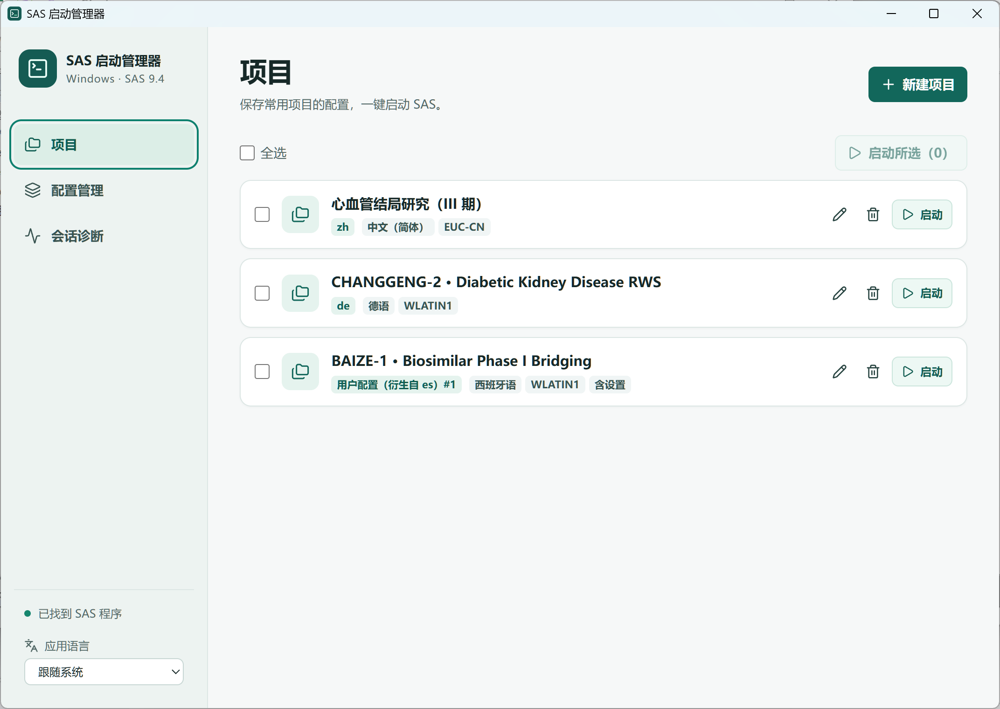

# SAS Launcher

Run several SAS 9.4 projects side by side, each with its own session environment.


[](https://github.com/wtwang1998/sas-launcher/actions/workflows/ci.yml)

**English** | [简体中文](./README.zh-CN.md)

## Why

SAS is happy to open more than one window. What it cannot do is keep their user settings apart — fonts, colors, window state and the default `PROC TEMPLATE` store all live in one user folder (`SASUSER`), and SAS requires exclusive update access to it ([RSASUSER system option](https://support.sas.com/documentation/cdl/en/hostwin/69955/HTML/default/n0npwfu9o7rvtun1f8f4ztpug83z.htm)).

The second window therefore falls back to a copy in Work: default appearance, changes discarded when it exits.

> `NOTE: Unable to open SASUSER.PROFILE. WORK.PROFILE will be opened instead.`

Output is blocked harder. A project's own ODS RTF templates cannot be written into that folder, so `PROC TEMPLATE` errors out and the tables come out in the default style — the window runs programs but cannot produce your tables. The official `ODS PATH` workaround covers templates only, not preferences; a shortcut per project does work, but it is one more icon to maintain per project.

SAS Launcher gives every project its own configuration and hands each launch a private, writable `SASUSER` directory that is deleted when the session ends. Projects can then produce tables at the same time without touching each other's settings.



## Features

**Configuration, three ways**

- Follow the installation default, pick one of the factory NLS configurations (`zh`, `u8`, `en`, … — one per `nls\<code>\sasv9.cfg`, typically 20 or more), or derive a user configuration from either of them.
- A user configuration is a three-line thin `sasv9.cfg` — `-CONFIG` pointing at the factory file, plus an encoding and a locale — with an optional snapshot of four SAS catalog files. No factory text is copied, so a SAS upgrade is inherited rather than repaired.
- Change the encoding and locale from a form, or open a dedicated SAS session to adjust UI preferences and save the catalogs back afterwards.


**One environment per window**

- Every launch gets its own writable `-SASUSER` directory, deleted when the session exits.
- Batch-launch the projects you use daily; projects that are already running are skipped.

**Diagnostics you can act on**

- Each record keeps the resolution chain (thin cfg → factory cfg → effective encoding, locale and `SASUSER`), the exact argv, the stage that failed and the exit code.
- The SAS log is captured with `-ALTLOG`, as a copy: the Log window still behaves as usual. Only the latest 20 records are kept.


## Requirements

> [!IMPORTANT]
> SAS Foundation 9.4 must already be installed and licensed on the same machine. SAS Launcher only launches it; it does not bundle SAS.

- Windows 10 or 11, x64
- SAS Foundation 9.4 (verified with TS1M7)
- WebView2 Runtime — included in Windows 11; Windows 10 may need the Evergreen Runtime

## Install

1. Download `SAS-Launcher-0.2.0-x64-Setup.exe` from [Releases](https://github.com/wtwang1998/sas-launcher/releases).
2. The installer installs for the current user into `%LOCALAPPDATA%\SAS Launcher`; no administrator rights are needed.
3. Upgrades and uninstalls reuse that folder.

> [!NOTE]
> The installer is not code-signed, so SmartScreen warns that "Windows protected your PC". That is expected for unsigned builds: choose **More info** → **Run anyway**. Only download it from this repository's Releases page.

### Data and uninstall

Projects, configurations and diagnostics live in `%LOCALAPPDATA%\com.saslauncher.desktop`, independent of where the program was installed. Uninstalling removes the program files only — your data survives. Delete that folder by hand to start from a clean state.

## Quick start

1. Launch the app. It finds an installed SAS 9.4 automatically; if it cannot, the banner offers to pick `sas.exe`.
2. In **Configurations**, review the factory configurations, or derive a user configuration and adjust its encoding and locale.
3. In **Projects**, create a project: a name, one of the three configuration sources, and an optional note.
4. To change SAS UI preferences for a configuration, choose **Open SAS to adjust settings**, then exit SAS and save.
5. If a launch misbehaves, open **Diagnostics** to inspect the chain, the argv and the log.

## Known limitations

- The SAS **Enhanced Editor** font, colours and key bindings live in the Windows registry (`HKCU`). SAS offers no way to move them, so they cannot be isolated per configuration or saved. This is a SAS limitation, not a missing feature.
- Data from versions before 0.2 is not migrated: the old folder is archived to `_old-<date>` inside the app data directory, and the app starts clean.

## Build from source

Requires the Rust MSVC toolchain (edition 2024), Visual Studio C++ Build Tools, Node.js and the WebView2 Runtime. The repository pins Rust 1.99.1 in `rust-toolchain.toml` and Node 24.22.3 in `.nvmrc`, so `rustup` and `nvm` pick the right versions up on their own.

```powershell
winget install --id Rustlang.Rustup
winget install --id Microsoft.VisualStudio.2022.BuildTools --override "--wait --passive --add Microsoft.VisualStudio.Workload.VCTools --includeRecommended"

git clone https://github.com/wtwang1998/sas-launcher.git
cd sas-launcher
npm ci
npm run tauri dev
```

The first Rust build takes 3–10 minutes. Changes under `src/**` hot-reload; changes under `src-tauri/**` rebuild and restart the window.

| Command | Purpose |
| --- | --- |
| `npm run check` | every gate: formatting, lint, clippy, types, both test suites (~12 s) |
| `npm run test` / `npm run test:rust` | frontend (vitest) / backend (cargo test) |
| `npm run build` | type-check, then build the frontend |
| `npm run tauri build` | build the app and the NSIS installer into `src-tauri/target/release/bundle/nsis/` |

Working on the code with an AI agent? Start with [AGENTS.md](AGENTS.md): it carries the invariants a test cannot catch.

## Continuous integration

Every pull request and every push to `main` runs the same gate you run locally, on `windows-latest`, in three parallel jobs: `web` (formatting, lint, types, frontend tests, build), `rust` (cargo fmt, clippy, backend tests and a tracked `Cargo.lock`), and `commitlint`.

Pushing a `v<version>` tag starts the release workflow: it refuses to build unless the tag matches `package.json`, `src-tauri/Cargo.toml` and `src-tauri/tauri.conf.json`, builds the unsigned installer, and leaves it in a draft release for review.

Contributions are welcome — see [CONTRIBUTING.md](CONTRIBUTING.md).

## License

[GPL-3.0-or-later](LICENSE).
